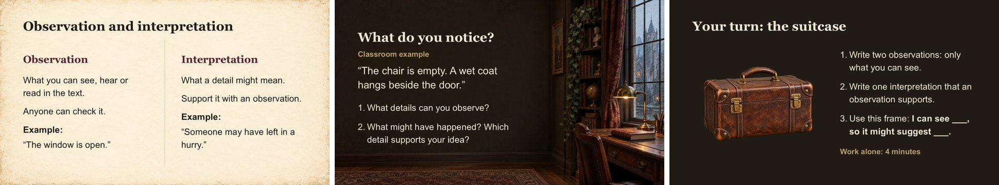

# AE Humanities PPTs: coworker kit



An AI skill for making readable, editable **Academic English for Humanities** slides in a dark academia style: Georgia and Arial fonts, 20 teaching layouts, four lesson presets and 117 bundled images. It works with WorkBuddy, Kimi Code, Qwen Code, CodeBuddy, Trae, Codex and other AI assistants that support skills (the open [Agent Skills](https://agentskills.io) format).

## Install it in your AI assistant

Use the desktop or command-line version of your assistant, since it needs to work with files on your computer. Paste this:

```text
Please install the AE Humanities PPTs skill from https://github.com/leckwallnut/ae-humanities-coworker-kit

The skill is the folder artifact-template-ae-humanities-ppts in that repository. Copy that whole folder, keeping its name and everything inside it, into your personal skills folder so I can use it in every project. Do not change any files. Then tell me where you put it, and check that you can see a skill named artifact-template-ae-humanities-ppts.
```

Then start a new chat (or restart the assistant) and ask: "Which skills can you use?" The list should include `artifact-template-ae-humanities-ppts`.

If your assistant cannot download from GitHub, download the kit yourself (below), extract it, and follow [SETUP.md](SETUP.md). It explains where each assistant keeps its skills and how to copy the folder by hand.

## Download

- **The kit:** the [latest release](https://github.com/leckwallnut/ae-humanities-coworker-kit/releases/latest) has `AE-Humanities-Coworker-Kit-v1.1.zip`. The green **Code → Download ZIP** button on this page gives the same files.
- **Optional extras:** the same release page has `AE-Humanities-Coworker-Kit-v1.1-Extras.zip`, with the original PNGs and the visual guide PDFs. The skill does not need them.

GitHub can be slow or unreliable on some networks. If a download stalls, ask the person who sent you this link for the ZIP file.

## Try it

After installing, run the first-run test from [STARTER-PROMPTS.md](artifact-template-ae-humanities-ppts/STARTER-PROMPTS.md). It asks for a three-slide lesson on observation and interpretation. Compare the result with [what a good first-run result looks like](artifact-template-ae-humanities-ppts/references/first-run-check.md); the slides above are the reference result.

Then try one of the six starter prompts with your own lesson material:

```text
Use the AE Humanities PPTs skill (artifact-template-ae-humanities-ppts). Create a 5-slide editable 16:9 lesson explaining [concept] to [student level] in about 10 minutes. Use the attached source material. Include a clear definition, one concrete example, a useful comparison, a short check for understanding, and a closing task. Put suggested answers and sources in speaker notes. Use Georgia Bold headings, Arial body text, varied layouts and bundled images. Render and check readability before delivering the PPTX.
```

## What is inside

| Resource | Where |
| --- | --- |
| The skill | [artifact-template-ae-humanities-ppts](artifact-template-ae-humanities-ppts/SKILL.md) |
| Full guide to the kit | [START-HERE.md](START-HERE.md) |
| Setup for each assistant, and common fixes | [SETUP.md](SETUP.md) |
| 20 editable teaching layouts | [teaching-layouts.pptx](artifact-template-ae-humanities-ppts/assets/teaching-layouts.pptx) and the [slide index](artifact-template-ae-humanities-ppts/references/layout-library.md) |
| Example lessons | [examples](examples/README.md) |
| 117 images | [Image library](artifact-template-ae-humanities-ppts/references/image-library.md) |
| Fonts and readable text | [FONT-GUIDE.md](FONT-GUIDE.md) |
| PowerPoint checks (Windows) | [Render, fit-check and animate](artifact-template-ae-humanities-ppts/references/powerpoint-checks.md) |

You can also use the layouts and images by hand in PowerPoint, without any assistant.

## Good to know

- Install **Georgia and Arial** on the computers that make and present the slides.
- The images are AI-generated illustrations, not documentary evidence. See [CREDITS.md](CREDITS.md).
- Motion (fades and click reveals) is still a pilot. Click through the actual file before class.

## License

The kit is shared under [CC BY-NC 4.0](LICENSE): you may use, share and adapt it for non-commercial purposes, with credit to "AE Humanities PPTs coworker kit by leckwallnut". Quoted classroom sources keep their own credits, listed in the decks' notes.
